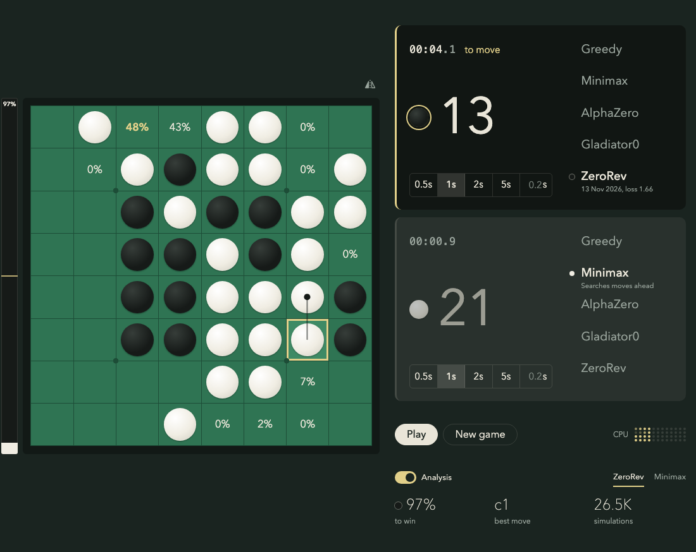
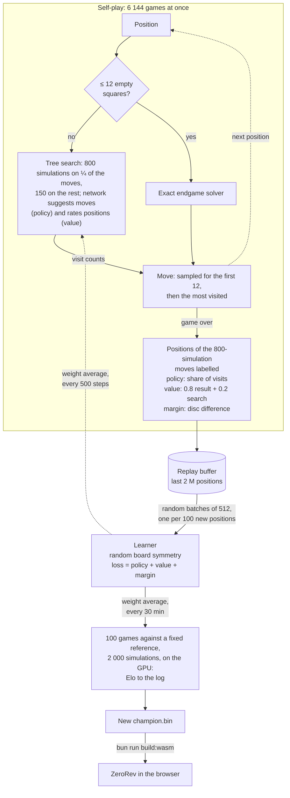
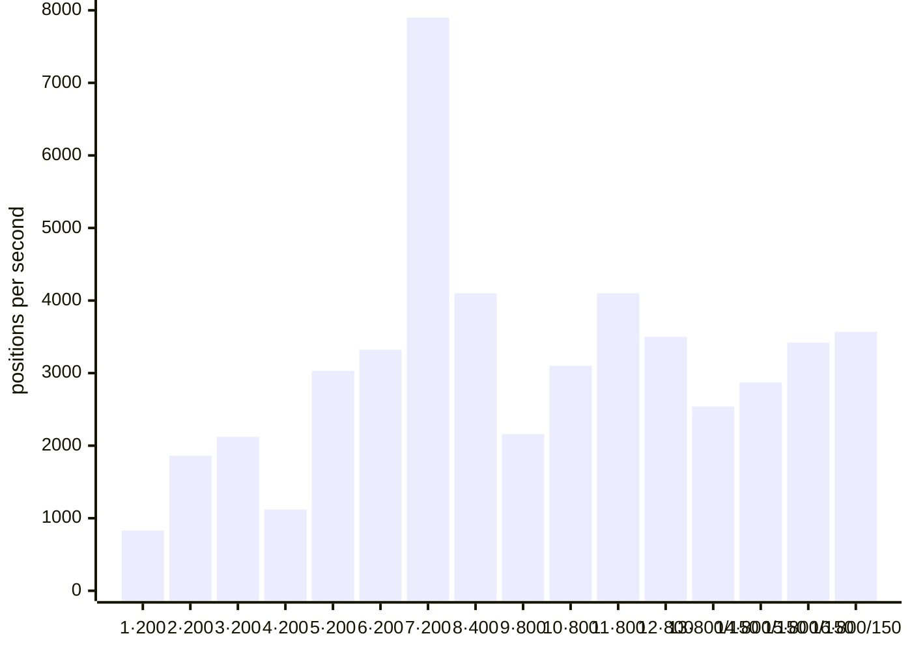

# Reversi

[Reversi (Othello)](https://en.wikipedia.org/wiki/Reversi) in the browser, against
bots. Three of them use networks that taught themselves the game.



*ZeroRev (black) trails Minimax 13–21 in discs, yet rates its chances at 97 %.*

The bots run in the browser as WebAssembly, with a time per move, on several
threads where the page allows it:

| Bot | Plays by |
|---|---|
| Greedy | flipping the most discs |
| Minimax | [alpha-beta search](https://en.wikipedia.org/wiki/Alpha%E2%80%93beta_pruning) over a hand-written score: mobility, corners, discs |
| ZeroRev | tree search guided by a neural network trained by self-play |
| Gladiator0 | ZeroRev's engine with frozen weights from step 1 239 000 |
| AlphaZero | the same engine, weights of an earlier run |

## How ZeroRev learns

ZeroRev learns the way [AlphaZero](https://arxiv.org/abs/1712.01815) does: it
starts knowing only the rules and gets better by playing against itself. No
human games, no hand-written evaluation.



**Self-play.** The current network plays against itself, 6 144 games at once
so that the GPU always gets large batches. Before each move it runs a
[Monte Carlo tree search](https://en.wikipedia.org/wiki/Monte_Carlo_tree_search)
of 800 simulations: the network's *policy* head suggests which moves to try,
its *value* head judges the positions the search reaches. The search plays
noticeably better than the network alone, and that gap is what the network
learns from. Only a random quarter of the moves get the full search and
become training examples; the rest are played after a quick 150-simulation
search ([playout cap randomization](https://arxiv.org/abs/1902.10565), from
KataGo). That gives about 2.5 times more games for the same work.

**What it learns.** Every position becomes a training example with three
targets:

1. *policy*: how the search spread its visits over the moves, so that the
   network suggests good moves without searching;
2. *value*: who won that game (80 %) and how the search rated the position
   (20 %), so that the network judges a position at a glance;
3. *margin*, auxiliary: by how many discs the game was won, e.g. 40:24 is +16
   for the winner (scaled to ±1). "Won" and "won big" are different
   positions, and the margin lets the network tell them apart. The bots do not
   use this output.

**Training.** Positions go into a replay buffer that keeps the last 2 M of them
(about 33 000 games). The learner draws batches of 512 from it, one step per
100 new positions, so each position is used about 5 times before it ages out.
Every 500 steps self-play gets new weights: not the latest step's, but their
moving average over the last ~10 000 steps (EMA), which plays better than any
single step. A better network plays better games, and those make better
examples.

**Champion.** Every 30 minutes the weight average becomes the champion, the
version the browser bot is built from. Before that it plays a fixed reference
(the step 2 109 942 champion) 100 games at 2 000 simulations, closer to how the
browser bot thinks, in pairs from one random opening, each colour once. All
games run on the GPU at once, in under a minute. The result only goes to the
log as an Elo trend: 100 games tell ±55 Elo, and seeing +10 Elo would take
about 4 000. Gating by
[SPRT](https://en.wikipedia.org/wiki/Sequential_probability_ratio_test) at
400 games on the CPU took 30 minutes and stayed inconclusive.

Where it differs from AlphaZero:

| | AlphaZero (chess) | ZeroRev |
|---|---|---|
| Network | 19 residual blocks × 256 channels | 4 × 32 |
| Simulations per move | 800 | 800 |
| Targets | move, result | move, result, final disc margin |
| Board symmetries | none | each position in a random one of 8 |
| Endgame | searched | solved exactly from 12 empty squares |
| Self-play network | latest weights | weight average (EMA) |
| Self-play hardware | 5 000 TPUs | one laptop: RTX 3080, Ryzen 9 5900HX |

## Progress

### Strength

- Rows: champions in order; bold rows: what changed in between.
- vs Minimax: games against the Minimax bot at 300 ms per move, both colours.
- ● win, ○ loss.
- Loss compares only within one scheme: the fixes changed what it measures.

| Step | Loss | vs Minimax | Change / note |
|---:|---:|---|---|
| | | | **Old scheme**: learning rate halved every 5 000 steps to 10⁻⁵, each position trained on ~50 times, champion by 18-game matches |
| 522 000 | 2.02 | ●○ | |
| 624 000 | 2.03 | ●○ | |
| 639 000 | 1.93 | ●● | |
| 1 239 000 | 1.85 | ●○ | Gladiator0 |
| | | | **Training fixed** (table below); Rust self-play; 200-game matches |
| 1 354 500 | 1.73 | — | |
| | | | **Faster self-play**: tree reuse, endgame solver, evaluation cache |
| 1 569 467 | 1.68 | ●●●●●●●●●● | |
| 1 633 050 | 1.68 | ●●●●●○○○○○ | |
| | | | **400 simulations**, 2 M-position buffer |
| 1 883 761 | 1.70 | ●●●●●●●●●○ | |
| 2 109 942 | 1.66 | ●●●●●●●●●○ | beat 1 569 467 in both games; reference for the matches since |
| | | | **800 simulations** |
| | | | **Playout cap randomization**, weight average (EMA), value target 0.8 result + 0.2 search; champion = weight average every 30 min, no gating |
| 3 360 000 | 1.31 | ●●●●●●●●●● | current; 55.5 % against 2 109 942 (100 games, 2 000 simulations) |
| | | | **Learning rate back up** to 10⁻⁴ after 1.3 M steps at 3·10⁻⁵ without gains; longer stages down |

### Fixes

What the old scheme did wrong, fixed at step 1 239 000:

| Problem | Fix |
|---|---|
| Learning rate at its 10⁻⁵ floor for 1.2 M steps | Warmup, 3·10⁻⁴; 10⁻⁴ from 300 k steps; 3·10⁻⁵ from 800 k |
| One step per 10 new positions: each trained on ~50 times | One per 100: ~5 times |
| A champion every minute from 18 games: noise | 200 games every 30 minutes, 55 % to win |
| Total loss looked stuck: its floor is the entropy of the search's move choice | `policy_kl`, `value`, `margin` logged separately |
| Board symmetries unused | Each position in a random one of 8 |
| Value learned only win / draw / loss | Auxiliary head for the final disc margin |

### Speed

- Positions/s: training positions from self-play per second, on the laptop.
- Bar label: row · simulations per move. Compare bars with equal simulations.
- Rows 13–16 record only a quarter of the moves: fewer positions per second,
  but more games (55 → 92 → 106 → 127 → 134 per second).
- Steps/s: gradient steps (batch 512; row 16: 1 024). From row 7 at 200 simulations the
  learner, sharing the GPU, sets the pace: 7 900 positions/s would allow 79.
- Source: the training log over steady minutes; rows 1, 2, 4 are short runs.
  Rough figures, not benchmarks.



| # | Change | Sims | Positions/s | Steps/s | GPU °C |
|---:|---|---:|---:|---:|---:|
| 1 | Python self-play, 1 process | 200 | 830 | 8 | 66 |
| 2 | 4 processes | 200 | 1 860 | 19 | 80 |
| 3 | Rust self-play: one process, one GPU thread | 200 | 2 120 | 21 | 77 |
| 4 | GPU limit lowered to 70/74 °C: paused 20–65 % of the time | 200 | 1 120 | 16 | 75 |
| 5 | GPU clock capped at 1 300 MHz | 200 | 3 030 | 29 | 74 |
| 6 | Capped at 1 100 MHz: lower voltage, almost no pauses | 200 | 3 320 | 28 | 74 |
| 7 | Tree reuse, no search for single moves, endgame solver, evaluation cache | 200 | 7 900 | 36 | 68 |
| 8 | 400 simulations, 2 M-position buffer | 400 | 4 100 | 41 | 67 |
| 9 | 800 simulations; the CPU becomes the bottleneck | 800 | 2 160 | 22 | 60 |
| 10 | Search tree in contiguous arrays, PUCT once per node: +45 % per thread | 800 | 3 100 | 32 | 66 |
| 11 | Cache looked up by the search threads, not the GPU thread | 800 | 4 100 | 40 | 67 |
| 12 | Half as many games at once (6 144): 12 k trees took > 12 GB and were OOM-killed | 800 | 3 500 | 35 | 65 |
| 13 | Playout cap randomization: ¼ of the moves at 800 simulations and recorded, the rest at 150 | 800/150 | 2 540 | 25 | 66 |
| 14 | 8 search threads with two game pools each: one searches while the other waits for the GPU. Alone +53 %; next to the learner the GPU is the limit | 800/150 | 2 870 | 29 | 68 |
| 15 | CUDA graphs: the network's ~30 kernels launched with one call, 1.07 ms instead of 1.55 per 768 positions; 12 search threads to keep up | 800/150 | 3 420 | 34 | 70 |
| 16 | Learner: batch 1 024 at one step per 200 positions (same reuse), fused AdamW, batches and replay saves on background threads; half the learner's GPU time per position | 800/150 | 3 570 | 18 | 70 |

## Running it

Give this prompt to your AI coding agent:

```text
Set up this repository (browser Reversi with AlphaZero-style bots) on this
machine. Read AGENTS.md and the Justfile first.

1. The game: install Bazelisk (as `bazel`), Bun, and Rust nightly with
   rust-src and the wasm32-unknown-unknown target; run `bun install && bun dev`
   and open http://localhost:5173.
2. Training, only if I ask for it. Install just and uv, then
   `cd python && uv sync && uv run maturin develop --release --features python`
   and `uv run python -m train.test_smoke`. The backend follows the machine:
   - Apple Silicon Mac: MLX, self-play in Python.
   - Linux with an NVIDIA GPU: PyTorch on CUDA; build the Rust self-play with
     `just build-selfplay` and train with `REVERSI_SELFPLAY=rust`.
   Start with `just train <run>`, follow with `just logs <run>`, stop with
   `just stop <run>`. The run `zerorev` continues the shipped ZeroRev weights;
   a new name starts from scratch.
3. The training defaults fit the author's laptop (see the README). Fit them
   to my hardware before a long run (REVERSI_*_TEMP_*, REVERSI_GPU_CLOCK,
   REVERSI_SELFPLAY_RUST_ARGS) and watch memory, temperatures and throughput
   in the log for the first minutes.
4. A new champion reaches the browser after `bun run build:wasm`;
   `just vs-minimax 300 10 0.2` plays it against Minimax.
```

The training defaults are tuned for my laptop; on other hardware they are a
starting point:

| | Hardware | Default |
|---|---|---|
| GPU | RTX 3080 Laptop | slows down at 70 / 74 °C (soft / hard limit); clock capped at 1 100 MHz |
| CPU | Ryzen 9 5900HX, 16 threads | slows down at 85 / 90 °C; 12 search threads |
| RAM | 32 GB | 6 144 self-play games at once, ~6 GB |

By hand:

- Requirements as in step 1 of the prompt.
- Threads in the browser need the page served with
  `Cross-Origin-Opener-Policy: same-origin` and
  `Cross-Origin-Embedder-Policy: require-corp`. Vite sends both.

```sh
bun install && bun dev            # the game at http://localhost:5173
bun run build                     # production bundle in apps/web/dist
bun run install:browsers          # once, for the e2e tests
bazel test //... && bun run test:unit && bun run test:e2e
just fmt && just lint
```

## License

[MIT](LICENSE-MIT) or [Apache-2.0](LICENSE-APACHE), at your option.
